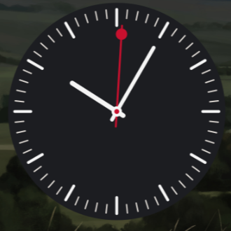
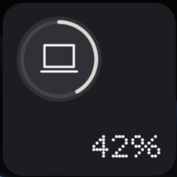
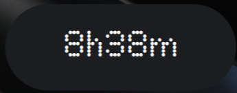
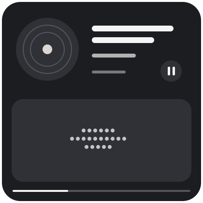
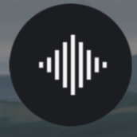
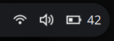

# Nothing Interface for Ryoku

**Серые поверхности. Точечные часы. Бар из островов.** Неофициальная тема для [Ryoku](https://ryoku.dev): оформление QS Bar и набор виджетов рабочего стола по мотивам Nothing OS.

[English](README.en.md) · [Установка](#установка) · [Состав](#что-внутри) · [Настройка](#настройка-под-себя)

> [!NOTE]
> Скриншот всего рабочего стола появится позже. Обои в репозиторий не входят: тема оставляет выбранное вами изображение.

## Виджеты

| Аналоговые часы | Батарея | Время за компьютером |
| :---: | :---: | :---: |
|  |  |  |

| Медиа | Звук · дополнительно | Индикаторы бара |
| :---: | :---: | :---: |
|  |  |  |

В комплекте также есть **большие точечные часы с датой** на рабочем столе и **бар из трёх островов**. В центре бара остаются обычные часы Ryoku и медиаплеер. Значок запуска — четыре нейтральные точки; сеть, звук и питание — монохромные. Красный появляется только на секундной стрелке и при критическом заряде.

## Что внутри

| Путь | Назначение |
| --- | --- |
| [`theme/`](theme/) | Пресет Ryoku, фиксированная серо-графитовая палитра и четыре пользовательских QML-оформления |
| [`plugins/`](plugins/) | Шесть независимых плагинов Ryoku с исходниками, манифестами и превью |
| [`theme/layout-example.json`](theme/layout-example.json) | Пример расположения виджетов для экрана 1920 × 1080; не загружается автоматически |

Тема использует **Noto Sans** для основного текста и рисует крупные цифры точками в QML. Файлы фирменных шрифтов Nothing не распространяются. Для дополнительного текста секунд в часах можно установить NType 82 самостоятельно по ссылке в [разделе о шрифтах](#шрифты-и-обои).

## Установка

Нужен Ryoku с QS Bar и поддержкой плагинов. Тема собрана на **Ryoku 0.75.3**; пользовательские QML-файлы могут потребовать адаптации после обновлений оболочки. Плагины используют локальные `python3`, `playerctl`, `nmcli` и `wpctl` там, где это указано в их манифестах.

### 1. Получить исходники

```bash
git clone https://github.com/venchik111/ryoku-nothing-interface.git
cd ryoku-nothing-interface
```

### 2. Установить виджеты

```bash
for name in nothing-analog-clock nothing-dashboard nothing-media nothing-screen-time; do
  ryoku plugin add "plugins/$name" --yes
done
ryoku plugin add plugins/nothing-status --bar --yes
```

Круговой виджет звука необязателен: `ryoku plugin add plugins/nothing-audio --yes`. Исходники каждого плагина открыты для просмотра до установки.

### 3. Применить пресет

Сначала сохраните своё текущее оформление в Ryoku. Затем:

```bash
ryoku-hub rice import "$PWD/theme"
ryoku-hub rice apply nothing-interface
ryoku-shell dock hide
```

Пресет задаёт форму и расположение элементов бара, палитру и штатные часы рабочего стола. **Он не меняет обои.** Если часы бара отсутствуют после применения, верните их через **QS Bar Settings → Layout** или `ryoku-shell bar move clock --section center --index 0`.

### 4. Добавить точечные часы и знак запуска

Для оформления, показанного в проекте, скопируйте QML-файлы в пользовательский слой Ryoku. Сначала сделайте резервную копию существующего слоя:

```bash
if [ -d "$HOME/.config/ryoku/user_edits" ]; then
  cp -a "$HOME/.config/ryoku/user_edits" \
    "$HOME/.config/ryoku/user_edits.before-nothing-$(date +%Y%m%d-%H%M%S)"
fi
mkdir -p "$HOME/.config/ryoku/user_edits"
cp -a theme/user_edits/. "$HOME/.config/ryoku/user_edits/"
ryoku reload
```

Эти файлы переопределяют только часы рабочего стола, дату, часы бара и значок запуска. Они не затрагивают поставляемые файлы Ryoku. Если у вас уже есть собственные правки **этих четырёх файлов**, сохраните их отдельно перед копированием.

### 5. Расставить плитки

Откройте **Ryoku Hub → Widgets** и расставьте установленные виджеты. [`layout-example.json`](theme/layout-example.json) показывает композицию для 1920 × 1080; на другом мониторе положение и масштаб лучше подобрать вручную. Для небольшого зазора между баром и окнами установите внешние отступы **8** в **Ryoku Hub → Window Manager**. Форму островов и содержимое бара можно менять в **QS Bar Settings → Bars / Layout / Community**.

## Настройка под себя

- **Цвета:** `#1C1D21` и `#303136` для поверхностей, `#F5F5F5` для текста, `#C2C4CB` для второстепенных деталей. `#C8102E` используется очень редко.
- **Бар:** оставьте нужные системные индикаторы в QS Bar Settings → Widgets; виджет `nothing-status` настраивается в Community.
- **Музыка:** плитка читает локальный MPRIS и тот же источник текста песен, что штатный виджет Ryoku. Если слов нет, она сообщает об этом.
- **Время за компьютером:** плитка читает сегодняшний итог штатного счётчика Ryoku. Данные обновляются с задержкой до записи счётчика на диск.
- **Откат:** примените сохранённый перед установкой пресет Ryoku, удалите плагины через Ryoku Hub → Add-ons и восстановите резервную копию `user_edits`, если копировали QML-оформление.

## Шрифты и обои

Основной текст работает с Noto Sans. Оригинальные шрифты Nothing не включены из-за условий распространения; ссылка на их файлы и правила применения есть в [Nothing Brand Reference](https://nothing.wiki/nothing/brand_reference). Большие точечные цифры не требуют этих шрифтов.

Обои выбираются отдельно через **Super+W**. [Официальная публикация Nothing Launcher Beta](https://nothing.community/d/617-a-glimpse-of-nothing-os-nothing-launcher-beta-is-here) содержит ссылку на набор обоев.

## Статус проекта

Это фанатская тема, не связанная с Nothing Technology Limited. Названия и товарные знаки Nothing принадлежат их правообладателям. Ориентир по палитре и типографике — [публичный справочник сообщества](https://nothing.wiki/nothing/brand_reference). Собственные плагины, пресет и материалы проекта распространяются по [MIT](LICENSE). Адаптации QML сохраняют лицензии Ryoku — подробности в [NOTICE.md](NOTICE.md). Шрифты и обои Nothing в комплект не входят.
