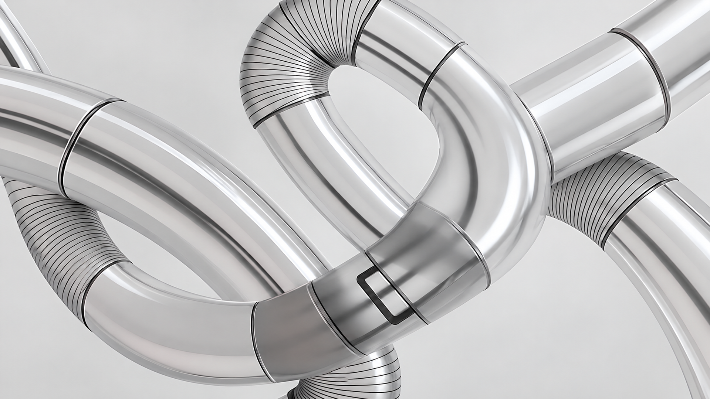
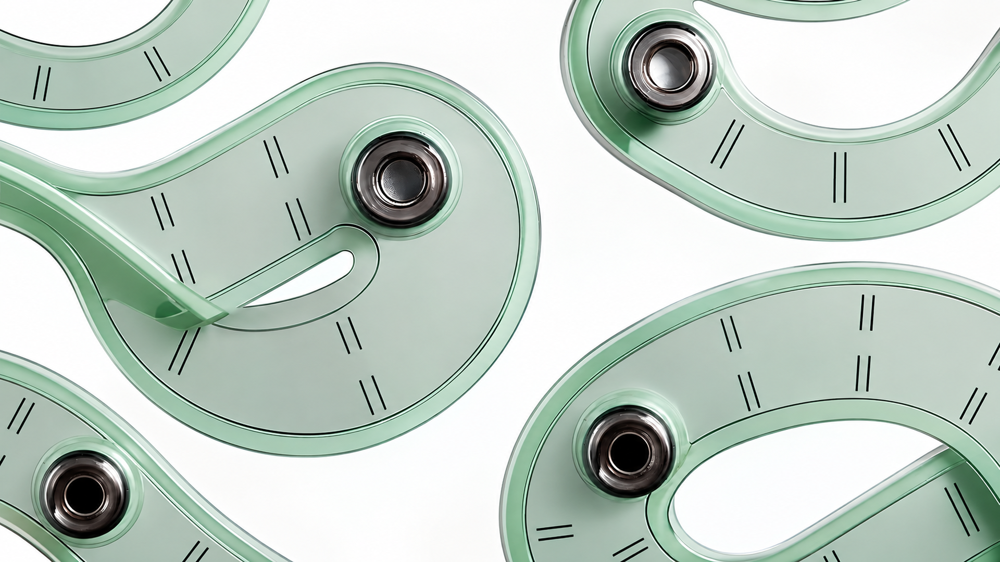
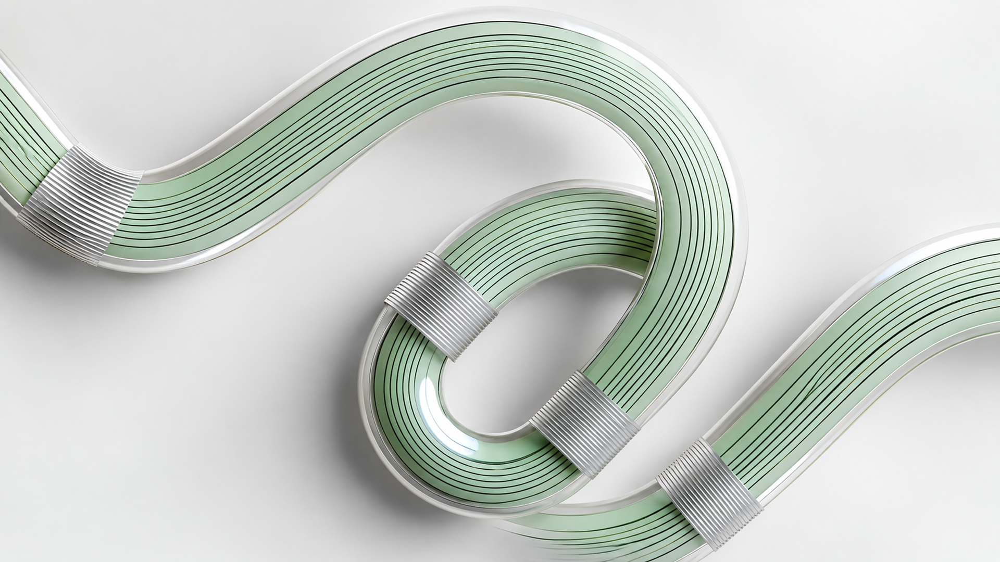
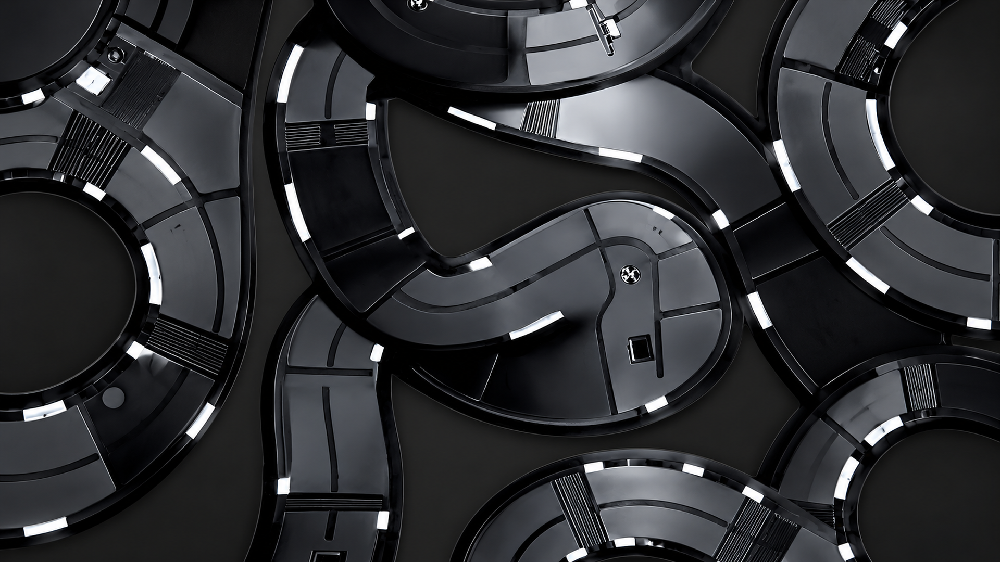
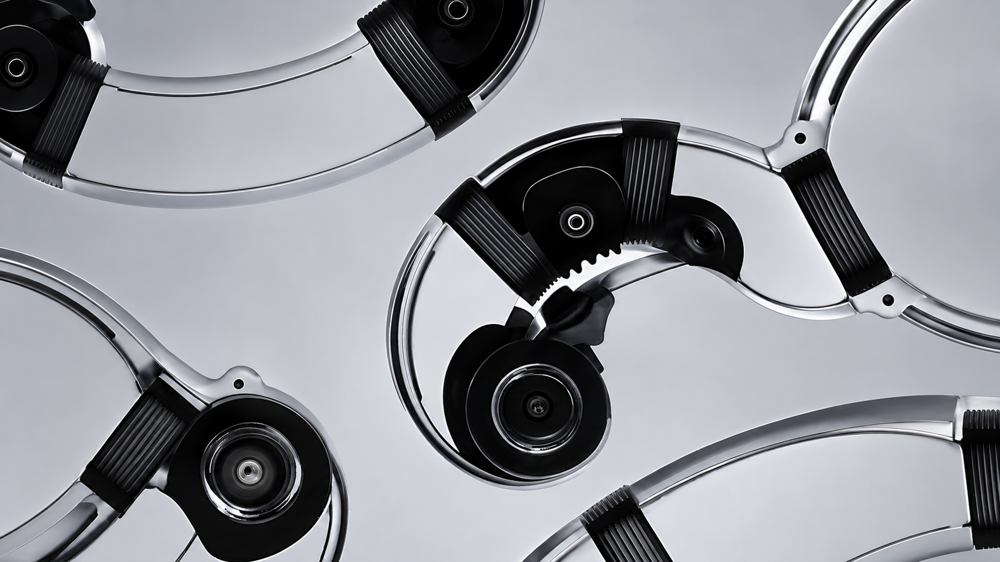
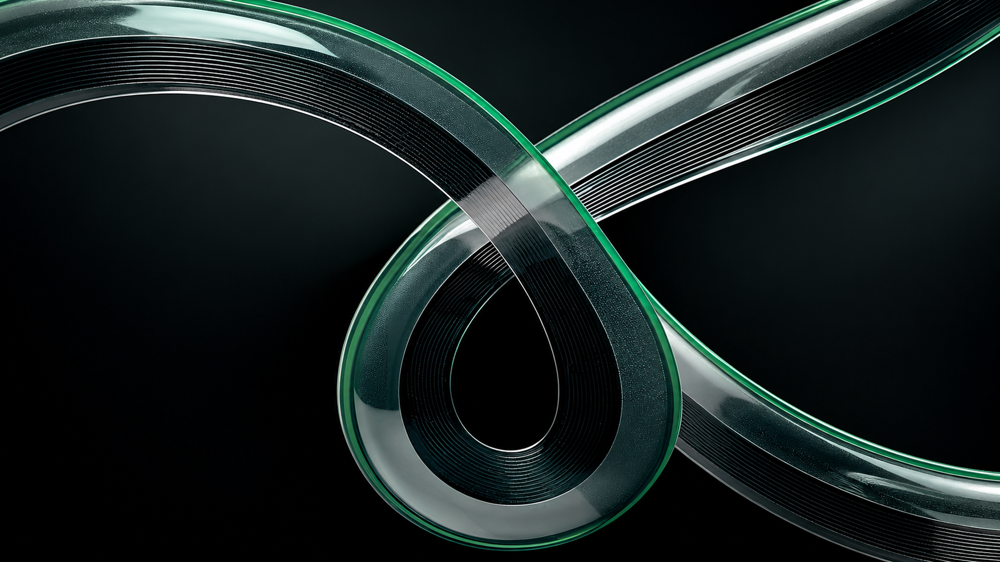

# Connected Collection — AI-generated 16:9 adaptations

[Русский](#русский) · [English](#english)

## Русский

Здесь находятся шесть **неофициальных обоев 1920 × 1080, сгенерированных ИИ**: телефонные изображения Connected Collection были использованы как основа для расширения композиции до 16:9 с помощью **OpenAI ImageGen**. Это новые ИИ-адаптации, а не оригинальные обои Nothing для компьютера. Оригинальные вертикальные файлы в репозиторий не добавлены.

Автор исходной концепции Connected Collection — **Андрес Матеос**. [Nothing описывает его работу и процесс создания](https://nothing.community/d/10440-the-community-edition-project-wallpaper-design-winner). Проект не связан с Nothing и не получает от компании одобрения. Лицензия MIT в корне репозитория **не распространяется** на эти изображения и не передаёт права на исходную работу; подробнее — в [NOTICE.md](../NOTICE.md).

Чтобы добавить обои в выбор Ryoku, скопируйте нужные PNG в `~/Pictures/Wallpapers`, затем откройте меню обоев через **Super+W**. Тема не меняет текущие обои автоматически.

## English

These are six **unofficial, AI-generated 1920 × 1080 wallpapers**. The phone-sized Connected Collection images served as references for extending the compositions to 16:9 with **OpenAI ImageGen**. They are new AI adaptations, not official Nothing desktop wallpapers. The original portrait files are not included.

The original Connected Collection concept is by **Andrés Mateos**. [Nothing's announcement credits his work and describes his process](https://nothing.community/d/10440-the-community-edition-project-wallpaper-design-winner). This project is independent of and not endorsed by Nothing. The repository's MIT license **does not cover** these images or grant rights to the underlying artwork; see [NOTICE.md](../NOTICE.md).

Copy the PNG files you want into `~/Pictures/Wallpapers`, then open Ryoku's wallpaper picker with **Super+W**. The theme does not change your current wallpaper automatically.

## Gallery · Галерея

| 01 | 02 |
| :---: | :---: |
|  |  |

| 03 | 04 |
| :---: | :---: |
|  |  |

| 05 | 06 |
| :---: | :---: |
|  |  |
